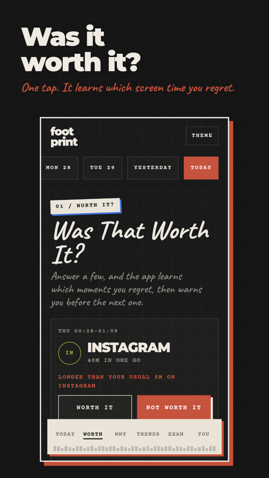
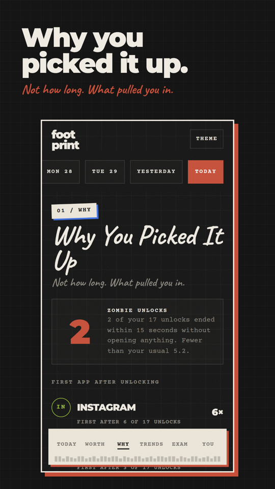
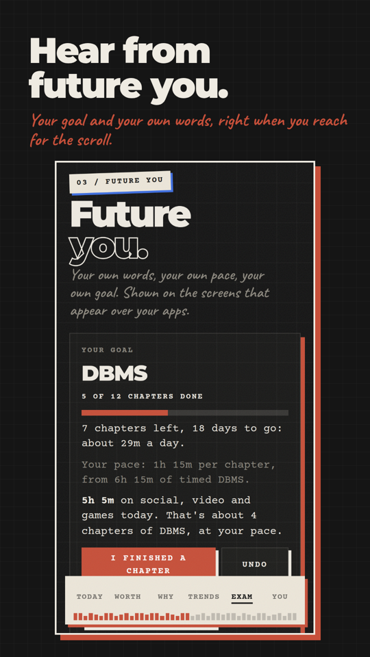
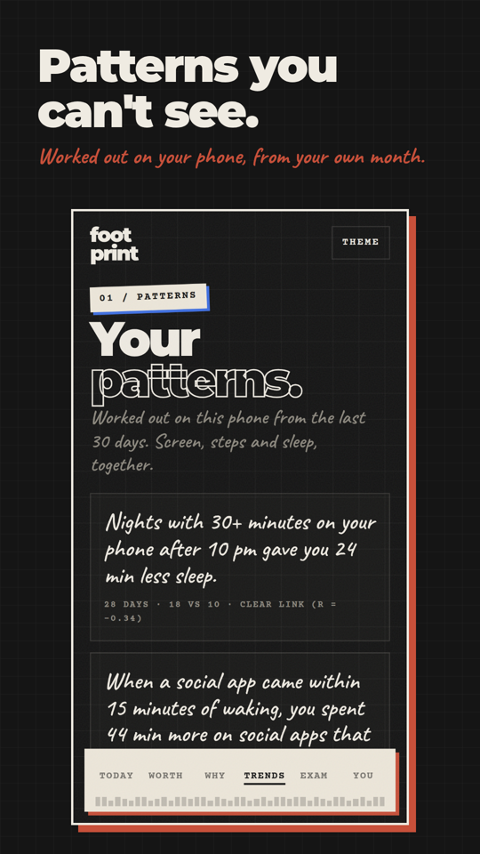

# Footprint

An Android app that learns **which** screen time you regret and warns you before the next one, instead of just counting hours. Free, no ads, no accounts. Everything runs on the phone: the app has **no internet permission**, so nothing can leave the device.

<p align="center">
  
  
  
  
</p>

<sub>Screens use the dashboard's built-in sample data, not real usage.</sub>

```
android/   the app (Kotlin): collectors, local database, widget, WebView host
web/       the dashboard (HTML/JS/fonts) bundled into the app, plus the analytics engine and its tests
play/      release guide, privacy policy, store listing, data safety answers
v2/        the laptop pairing release: FastAPI server, Windows agent, deploy scripts (not built into v1)
```

## What it collects, on the phone only

App sessions, unlocks, screen on/off, notification events (via usage access) and steps (step-counter sensor). If you use them: your answers to "why are you opening this?", what you did on each rule screen, and the study sessions you time. The last 90 days are kept. No message or notification content is ever read.

## How it's laid out

Six tabs, not one long page: **Today** (screen time, app orbit, ranked apps), **Worth** (the "worth it?" question, your regret summary and risky moments, notification triage), **Why** (zombie unlocks, first app after unlock, doom-scrolls, what you said before opening, how often rule screens held, the 24-hour timeline, night and morning, the ASCII week), **Trends** (patterns, steps, sleep), **Exam** (study timer, exam countdown, target and streak) and **You** (weekly receipt, export and delete). Each tab remembers where you scrolled, the day picker sticks to the top on day-based tabs, and the Android back button moves back through tabs before leaving the app.

## What it shows

- **Worth it?**: the app asks about one session at a time, learns which contexts you regret (late-night YouTube, notification-opened Instagram), shows how much of your day you'd take back, and nudges you a few minutes before your own risky windows
- **What keeps buzzing**: each app's notifications weighed against the minutes they actually cost you, with a one-tap link to that app's notification settings
- Screen time by app and category, with the real icons from your phone
- **Why you picked it up**: zombie unlocks, first app after unlocking, notifications that pulled you in, doom-scrolls over 20 minutes
- Sleep estimated from your last phone use at night and first unlock in the morning, plus phone-in-bed and morning-reach
- **Patterns** after ~7 days, connecting steps, sleep and screen time
- **App rules** (all optional, set per app in Settings): daily limit, opens a day, a break after N minutes in one go, and "why are you opening this?"; blocked times (study hours, night) for your distracting apps; weekend limits; a cap on "5 more minutes"; looser changes that wait until tomorrow; a "do this instead" idea on every rule screen
- **Week in review**: the last 7 days against the 7 before (screen time, late nights, unlocks, study, sleep, steps, rule screens), one small experiment to try next week and how the last one went, a shareable card, and a weekly notification
- **Walk for extra time**: walk 300–1000 steps on a rule screen to earn 10 more minutes
- **Reels and Shorts blocking** (full edition): closes YouTube Shorts, Instagram Reels and Snapchat Spotlight with an Accessibility service limited to those apps, after an in-app disclosure
- **Study timer**: 25/50/90 minutes or a stopwatch, by subject; distracting apps are locked until it ends, and the time counts as study in Exam mode
- **Exam mode**: countdowns, a daily study target and streak, study vs scrolling
- **Weekly receipt**: a shareable image of your week
- Home-screen widget with the week as an ASCII heatmap
- Export to JSON or CSV, and delete everything, at any time

## Two editions

`full` (default, what you install) has everything; `store` leaves out the Accessibility service so the first Play review needs no Accessibility declaration. Same package name and data. Pick one under **Build Variants** in Android Studio. Details in `play/RELEASE.md`.

## Settings

Everything in Settings changes real behaviour, not just the display:

| Setting | What it changes |
|---|---|
| Nudges on/off, how early (2–15 min), quiet hours | Whether and when warnings fire; quiet hours suppress both nudge types |
| Daily review reminder time | When the "sessions to review" reminder arrives, or off |
| Ask about sessions longer than (off / 3 / 5 / 15 min) | Which sessions "Worth it?" offers; off asks nothing |
| Steps goal, daily screen-time target | The goal line on the steps chart and the under/over label on today's total |
| Collect steps, collect notification events | Turns those collectors off entirely |
| Ignore naps shorter than (2 / 3 / 4 h) | The rule used to detect sleep |
| Keep history for (30 / 90 / 180 / 365 days) | Automatic deletion of older events |
| Hide apps | An app is never recorded again and its history is deleted immediately |
| App rules: per app | Daily limit, opens a day, break after, ask why. Shown as a full-screen page over the app |
| App rules: how strict | Extra time per app per day (any / 3 / 1 / none), break length, weekend limits (same / +50% / double / none), which days are the weekend, looser changes wait until tomorrow |
| Do this instead | The ideas shown on rule screens |
| Blocked times | Up to 6 windows (can cross midnight) when distracting apps show the blocked-time page |
| Distracting apps | Locked during blocked times and study sessions; starts as your social, video and game apps |
| Walk for extra time (off / 300 / 600 / 1000 steps) | Adds a "walk for 10 more minutes" button to rule screens |
| Weekly review (off / Fri / Sat / Sun, time) | When the weekly review notification arrives |
| Reels and Shorts (full edition) | Which feeds are closed, and whether always or only during blocked times and study sessions |
| Export JSON/CSV, Delete everything | Same as the dashboard, also available natively |

## Installing on your phone

Step by step in [`INSTALL.md`](INSTALL.md), including the Gradle download workaround and the Android 16 SDK.

## Developing

```bash
# analytics tests (no Android needed)
for t in analytics regret settings health worth body exam study review; do TZ=Asia/Kolkata node web/tests/$t.test.js; done

# Kotlin: type-check and JVM tests (need kotlinc and an android.jar, API 35+)
ANDROID_JAR=/path/to/android.jar android/tools/typecheck/check.sh
ANDROID_JAR=/path/to/android.jar android/tools/test/run.sh
python3 android/tools/widgetlint/check.py

# the dashboard in a browser, with sample data
cd web && python3 -m http.server 8123   # then open http://127.0.0.1:8123/index.html
```

The app: open `android/` in Android Studio (AGP 8.9.1, Gradle 8.11.1, compile/target SDK 36, minSdk 26) and press Run. `web/` is bundled as the app's assets, so editing the dashboard needs no Kotlin changes.

The dashboard talks to the app through `FootprintBridge`, a message channel exposed only to the app's own virtual origin: `data` (raw events), `prefs` (your settings), `status`, `collect`, `settings`, `export`, `share`, `wipe`, `nudges` (the schedule the app fires from), `notifSettings`, `labels`/`setLabel`/`delLabel`/`importLabels` (worth-it answers), `setPref`, `batterySettings`, and `focus`/`focusStart`/`focusStop` (the study timer). With no bridge present (a plain browser) it renders sample data instead.

## Releasing

See [`play/RELEASE.md`](play/RELEASE.md). Short version: pick a name, host the privacy policy, build a signed `.aab`, run a closed test with 12 testers for 14 continuous days, then apply for production.

## v2: pair with your laptop

`v2/` holds a working FastAPI server, a Windows tracking agent and deploy scripts that add laptop screen time over your phone's hotspot, with HMAC-signed requests. It was built and tested before v1 was split out, and it isn't part of the Play release.
